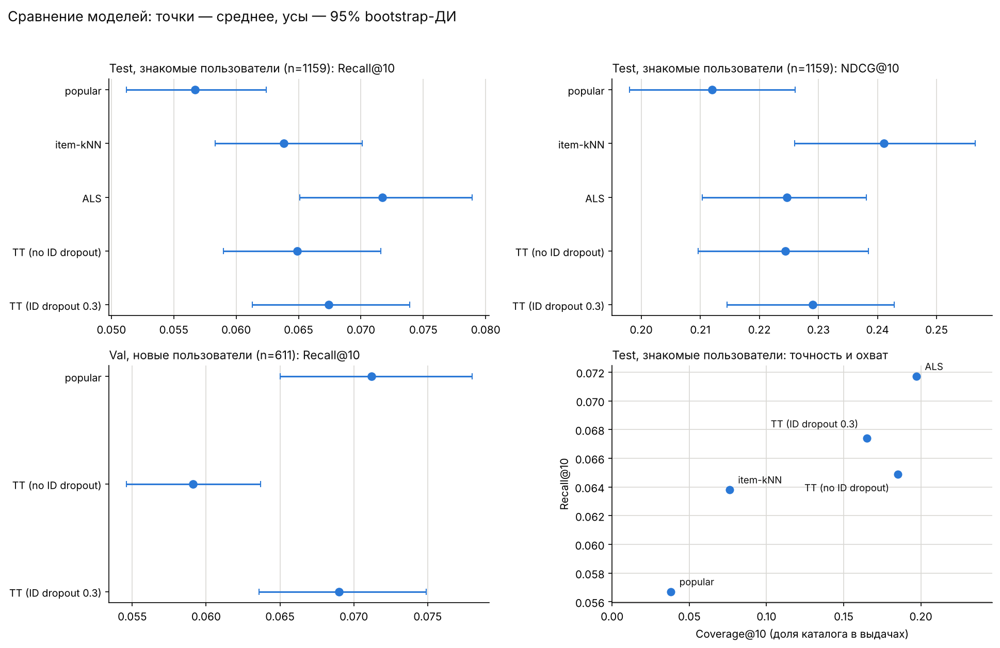

# Рекомендательные системы на MovieLens-1M

Учебный проект по основам рекомендательных систем: «лесенка» моделей от тривиального бейзлайна до двухбашенной нейросети, которые сравниваются по одному честному протоколу. Главная цель — не максимальная метрика, а понимание того, **как устроены основные семейства алгоритмов, откуда берётся popularity bias и как корректно сравнивать модели**.

Весь ход рассуждений, теория (формулы, интуиция) и неудачные эксперименты описаны в блокноте [`RecSys_MovieLens.ipynb`](RecSys_MovieLens.ipynb) на русском языке.

## Что внутри

| Шаг | Модель | Чему учит |
|---|---|---|
| 1 | Популярное (счётчик, демпфированное среднее) | задаёт планку; показывает, что такое popularity bias |
| 2 | Item-kNN (косинус, штраф за популярность, shrinkage) | коллаборативная фильтрация по соседям; почему косинус «любит» популярное |
| 3 | ALS для неявной обратной связи (`implicit`) | латентные факторы, подбор гиперпараметров, переобучение, winner's curse |
| 4 | Two-tower (PyTorch) | softmax по батчу, logQ-коррекция, признаки пользователей и фильмов, ID dropout для холодного старта |

## Протокол оценки

* **Данные:** [MovieLens-1M](https://grouplens.org/datasets/movielens/1m/), 1 000 209 оценок, 2000-04-25 — 2003-02-28. Положительным считается взаимодействие с оценкой ≥ 4 (57.5% всех оценок).
* **Разбиение по времени:** глобальные границы по квантилям `ts` (0.8 и 0.9), 800 164 / 100 024 / 100 021 оценок. Случайное разбиение дало бы утечку данных из будущего.
* **Ранжирование всего каталога** без выборки негативов; уже виденные фильмы исключаются.
* **Метрики:** Recall@10, NDCG@10, Coverage@10; отдельно для знакомых (warm) и новых (cold) пользователей.
* **Неопределённость:** bootstrap по пользователям (2000 повторов) и парные разности с доверительными интервалами.
* **Дисциплина:** гиперпараметры подбирались только на val; финальный прогон — обучение на `train + val` и **однократная** проверка на `test`.

## Результаты (test)

Знакомые пользователи, n = 1159:

| Модель | Recall@10 [95% ДИ] | NDCG@10 [95% ДИ] | Coverage@10 |
|---|---:|---:|---:|
| popular | 0.0567 [0.0512, 0.0624] | 0.2120 [0.1980, 0.2261] | 0.038 |
| item-kNN | 0.0638 [0.0583, 0.0701] | 0.2411 [0.2260, 0.2565] | 0.076 |
| ALS | 0.0717 [0.0651, 0.0789] | 0.2247 [0.2103, 0.2381] | 0.197 |
| TT (no ID dropout) | 0.0649 [0.0590, 0.0716] | 0.2244 [0.2096, 0.2385] | 0.185 |
| TT (ID dropout 0.3) | 0.0674 [0.0613, 0.0739] | 0.2290 [0.2145, 0.2428] | 0.165 |

Парные различия на знакомых пользователях (разность A − B; «различимо» означает, что 95% ДИ разности не содержит 0):

* item-kNN − popular: Recall +0.0071 (95% ДИ [0.0019; 0.0126]), NDCG +0.0291 (95% ДИ [0.0205; 0.0374])
* ALS − popular: Recall +0.0151 (95% ДИ [0.0081; 0.0226]), NDCG +0.0127 (95% ДИ [0.0004; 0.0259])
* ALS − item-kNN: Recall +0.0079 (95% ДИ [0.0019; 0.0148]), NDCG −0.0164 (95% ДИ [−0.0272; −0.0057])
* TT (ID dropout 0.3) − ALS: Recall −0.0044 (95% ДИ [−0.0105; 0.0015]), NDCG +0.0042 (95% ДИ [−0.0076; 0.0148]) — не различимо

Новые пользователи. На test их всего 29, поэтому интервалы очень широкие. Основные выводы для этого среза сделаны по val (n = 611):

| Модель | Recall@10 [95% ДИ] | NDCG@10 [95% ДИ] |
|---|---:|---:|
| popular | 0.0712 [0.0650, 0.0780] | 0.3685 [0.3476, 0.3896] |
| TT (no ID dropout) | 0.0591 [0.0546, 0.0637] | 0.3160 [0.2954, 0.3378] |
| TT (ID dropout 0.3) | 0.0690 [0.0636, 0.0749] | 0.3709 [0.3486, 0.3943] |

## Выводы

1. **«Популярное» — сильный бейзлайн.** Метрики точности поощряют популярные фильмы по построению (чтобы оценить фильм, его сначала нужно увидеть). Для новых пользователей ни одна из моделей не оказалась значимо лучше него.
2. **Персонализация на знакомых пользователях работает, но порядок моделей зависит от метрики.** Наибольший Recall@10 у ALS, наибольший NDCG@10 у item-kNN; ALS и kNN различимы по обеим метрикам, но в разные стороны.
3. **Two-tower не отличим от ALS** на этих данных (при одном зерне обучения).
4. **logQ-коррекция критична.** Без неё Recall@10 two-tower на val равен 0.0093 (охват 0.954), с ней — 0.0684. Высокий охват при низкой точности — признак поломки, а не разнообразия.
5. **ID dropout помогает на новых пользователях:** на val прирост Recall@10 +0.0099 (95% ДИ [0.0051; 0.0153]); но популярное на этом срезе всё равно не побеждено.
6. **Точность и охват тянут в разные стороны**, поэтому одной метрикой модели не сравнить.

## Ограничения

* MovieLens — это оценки, а не показы: «нерелевантно» означает «не оценено высоко», поэтому абсолютные значения метрик занижены, а оценка смещена в сторону популярного.
* Данные 2000–2003 годов.
* ALS и two-tower обучены на одном зерне: bootstrap учитывает шум от выбора пользователей, но не от случайности обучения.
* Two-tower не настраивался (размерность, температура, число эпох, архитектура взяты «по умолчанию»).
* Часть объяснений в блокноте — гипотезы, прямо не проверенные (в блокноте они оговорены).

